<!-- ========================= HEADER ========================= -->
<div align="center">



<br/>

<a href="https://yacineseybousiddo.me"></a>&nbsp;&nbsp;&nbsp;<a href="mailto:contact@yacineseybousiddo.me"></a>

<br/><br/>



<br/>


<br/>

**AI Systems Engineer · B.Sc. Artificial Intelligence · Niamey, Niger**

<sub>I build AI systems that ship, and I publish what I find — including the results that don't flatter the system. My work spans production AI engineering, six open-source AI/ML tools, and Cibiyar Karatu, an adaptive learning platform for Niger and the Sahel.</sub>

<br/>

<a href="mailto:contact@yacineseybousiddo.me"></a>
<a href="https://linkedin.com/in/yacineseybousiddoai"></a>
<a href="https://yacineseybousiddo.me"></a>

 Location: Niamey, Niger | Africa | Remote Worldwide &nbsp;·&nbsp;  Languages: French, English, Hausa, Zarma

<br/>

<!-- ========================= NAVIGATION ========================= -->
<a href="#what-i-do"></a>
<a href="#background"></a>
<a href="#open-source"></a>
<a href="#results"></a>
<a href="#client-work"></a>
<a href="#research-direction"></a>

<br/><br/>

<sub><b>Try the live apps</b></sub><br/>
<a href="https://intelai.ysiddo-ai-projects.app" title="Open IntelAI live"></a>
<a href="https://docintel.ysiddo-ai-projects.app" title="Open DocIntel live"></a>
<a href="https://rageval.ysiddo-ai-projects.app" title="Open RAGeval live"></a>
<a href="https://agentkit.ysiddo-ai-projects.app" title="Open AgentKit live"></a>
<a href="https://streampulse.ysiddo-ai-projects.app" title="Open StreamPulse live"></a>
<a href="https://voiceflow.ysiddo-ai-projects.app" title="Open VoiceFlow live"></a>

</div>

<br/>


<a id="what-i-do"></a>

##  What I Do

I work across three registers, and I try not to blur them.

<table>
<tr>
<td width="33%" valign="top">

###  AI systems engineering

Production RAG, multi-agent orchestration, automation, document intelligence, LLMOps, and edge/IoT platform solutions for client engagements.

</td>
<td width="33%" valign="top">

###  Open-source research tooling

Six standalone AI/ML tools, dual-licensed (AGPL-3.0 / commercial), each shipped with a public evaluation protocol rather than a marketing claim.

</td>
<td width="33%" valign="top">

###  Adaptive learning platform

*Cibiyar Karatu*, subject-agnostic and offline-first, for Niger and the Sahel — French alongside Hausa, Zarma, and Fulfulde — plus a parallel research contribution in corpus and benchmark work for those three languages, at very different starting points of existing NLP coverage.

</td>
</tr>
</table>


<a id="background"></a>

##  Background

<details open>
<summary><b>Education</b></summary>
<br/>

- **B.Sc., Artificial Intelligence** — African Development Universalis, Niamey (2022–2025), average 15.80/20. Coursework: mathematics for AI, algorithms, ML/DL, NLP, computer vision, databases, systems and networks.
- **Associate Data Scientist Program** — Qwasar Silicon Valley (2023–2024), 57 project-based assignments evaluated through automated grading and peer review, fully in English.

</details>

<details>
<summary><b>Certifications</b></summary>
<br/>

IBM Full Stack Software Developer · IBM RAG and Agentic AI · IBM AI Engineering · IBM Data Science Professional (all 2025) · Mathematics for Machine Learning and Data Science, DeepLearning.AI (2023). Full list of 19 on the [portfolio](https://yacineseybousiddo.me).

</details>

<details>
<summary><b>Teaching</b></summary>
<br/>

Instructor, *Introduction to Artificial Intelligence*, A.D.U. (2025) · workshop lead, Git/GitHub, Tech Communities Club A.D.U. · trainer, "Master AI Tools" workshop.

</details>


<a id="open-source"></a>

##  Open-Source Ecosystem — 6 tools, 2026, dual-licensed (AGPL-3.0 / commercial)

> Each tool ships with a `BENCHMARK.md` and a `RESEARCH.md` in its repository — the evaluation protocol and the raw numbers, favorable and unfavorable both. Summaries below; the repos are the source of truth.

<sub>Click any <b>Measured results</b> panel to expand it.</sub>

<br/>

<!-- ----------------------- IntelAI ----------------------- -->
###  [IntelAI](https://github.com/Yacine-ai-tech/intelai) — Persona-Aware Enterprise Analytics & RAG Copilot

[](https://pypi.org/project/intelai/) [](https://pypi.org/project/omnismart-personas/)
[](https://intelai.ysiddo-ai-projects.app) [](https://intelai.ysiddo-ai-projects.app/research) [](https://intelai.ysiddo-ai-projects.app/benchmark) [](https://intelai.ysiddo-ai-projects.app/guide) [](https://github.com/Yacine-ai-tech/intelai) [](https://github.com/Yacine-ai-tech/intelai/commits)

Nine C-suite personas (CEO, CFO, CTO, COO, CHRO, ESG, Risk, Analyst, General), each scoped to its own data domain by architecture, not prompt instruction. 146 curated KPIs across 9 domains, 78-month history (2020-01 to 2026-06). Hybrid retrieval (BGE-M3 dense 1024-dim + BM25 sparse + RRF fusion + BAAI/bge-reranker-v2-m3 cross-encoder reranking) with 100% live Qdrant precision, plus GraphRAG-lite multi-hop entity traversal and prompt caching with dynamic recency cutoff (June 2026).

<details>
<summary> <b>Measured results</b></summary>
<br/>

Out-of-sample backtest on 444 forecasts across 6 core metrics, Mean APE 4.64% (median 2.77%, down from 12.48% baseline without auto-selection); GraphRAG-lite reaches 100.0% entity extraction coverage (7,878/7,878 rows across all 7 operational domains) with 8/8 multi-hop queries verified; live production RAG scores 71.4% ground-truth accuracy across 50 verified cases; prompt-cached responses cite verified sources with inline bracketed numbers [1]. Published alongside those numbers: bilingual grounding parity is monitored across French and English with strict adherence to the verified reporting horizon.

</details>

<br/>

<!-- ----------------------- DocIntel ----------------------- -->
###  [DocIntel](https://github.com/Yacine-ai-tech/docintel) — Vision-First Document Intelligence

[](https://docintel.ysiddo-ai-projects.app) [](https://docintel.ysiddo-ai-projects.app/research) [](https://docintel.ysiddo-ai-projects.app/benchmarks) [](https://docintel.ysiddo-ai-projects.app/guide) [](https://github.com/Yacine-ai-tech/docintel) [](https://github.com/Yacine-ai-tech/docintel/commits)

Extracts structured data from PDFs, images, and scanned files across three production routes: Route A (Frontier Multimodal Vision: Claude Sonnet 4.6 / Gemini 3.8 Flash Native Vision), Route B (Self-Hosted Vision Model via Ollama: Qwen 2.5-VL 7B with zero cloud API cost), and Route C (Layout-Aware Surya OCR on GPU with Tesseract CPU fallback + LLM structured cleanup). Deterministic currency normalization across 45+ currencies (including FCFA/XOF under UEMOA VAT convention) and ISO dates, with SHA-256 document deduplication and sub-second cached retrieval.

<details>
<summary> <b>Measured results</b></summary>
<br/>

95.0% zero-shot accuracy on the public SROIE benchmark (57/60 receipts) and 100% on multilingual cloud-route invoices (Route A); 97.8% overall and 100% on French/FCFA sample (325/325 fields) on self-hosted Route B ($0 API cost); 96.3% field accuracy on Route C with Surya OCR + LLM cleanup; 650-document multi-format corpus processed at 100% throughput reliability (~1.1 docs/second).

</details>

<br/>

<!-- ----------------------- RAGeval ----------------------- -->
###  [RAGeval](https://github.com/Yacine-ai-tech/rageval) — Self-Hosted LLMOps Observability for RAG

[](https://pypi.org/project/omnismart-rageval/)
[](https://rageval.ysiddo-ai-projects.app) [](https://rageval.ysiddo-ai-projects.app/research) [](https://rageval.ysiddo-ai-projects.app/benchmarks) [](https://rageval.ysiddo-ai-projects.app/guide) [](https://github.com/Yacine-ai-tech/rageval) [](https://github.com/Yacine-ai-tech/rageval/commits)

```python
from rageval import track

@track(project="my_rag_app")
async def answer(question): ...
```

Zero-credit symbolic evaluation combined with a heterogeneous 4-judge consensus panel (Groq Maverick 17B, Gemini 3.5 Flash, Claude Haiku, GPT-5-mini), rate-limiting, and persistent SQLite/PostgreSQL disk caching.

<details>
<summary> <b>Measured results</b></summary>
<br/>

Folding the zero-credit symbolic judge (numeric consistency + lexical overlap) into the panel raises consensus ROC-AUC from 0.8709 to 0.9191 on HaluEval-QA (N=240); the 4-Judge Heterogeneous Consensus achieves 0.860 accuracy, 0.867 F1, and 0.902 ROC-AUC on HaluEval-QA (N=200). Panel disagreement standard deviation (0.217 on incorrect predictions vs 0.082 on correct ones) serves as an automated anomaly signal for human review.

</details>

<br/>

<!-- ----------------------- AgentKit ----------------------- -->
###  [AgentKit](https://github.com/Yacine-ai-tech/agentkit) — Governed MCP Tool Server

[](https://pypi.org/project/agentkit-mcp/)
[](https://agentkit.ysiddo-ai-projects.app) [](https://agentkit.ysiddo-ai-projects.app/research) [](https://agentkit.ysiddo-ai-projects.app/benchmark) [](https://agentkit.ysiddo-ai-projects.app/guide) [](https://github.com/Yacine-ai-tech/agentkit) [](https://github.com/Yacine-ai-tech/agentkit/commits)

Gives Claude Desktop, Cursor, or any LangGraph agent governed access to live business data through the Model Context Protocol — typed tool effects (read/write/destructive), capability policies, and deterministic audit logging.

<details>
<summary> <b>Measured results</b></summary>
<br/>

DSPy BootstrapFewShot metric score compiled from 0.6800 → 0.7067 (30/30 held-out examples); live MCP tool-selection and execution achieves 12/12 (100%) accuracy across standardized business intelligence scenarios on a running FastMCP server; 14/14 adversarial guardrail tests pass deterministically offline; LangGraph autonomous multi-agent workflows execute at 43/43 (100%) success across all 10 domains.

</details>

<br/>

<!-- ----------------------- StreamPulse ----------------------- -->
###  [StreamPulse](https://github.com/Yacine-ai-tech/streampulse) — Real-Time Business Data Pipeline

[](https://streampulse.ysiddo-ai-projects.app) [](https://streampulse.ysiddo-ai-projects.app/research) [](https://streampulse.ysiddo-ai-projects.app/benchmark) [](https://streampulse.ysiddo-ai-projects.app/guide) [](https://github.com/Yacine-ai-tech/streampulse) [](https://github.com/Yacine-ai-tech/streampulse/commits)

Multi-source ingestion (JSON, CSV, email, HMAC-verified webhooks, Google Sheets) with first-class n8n automation integration (custom node + 5 workflows) and a 3-tier hybrid classification cascade (regex/heuristics → semantic embeddings → LLM reasoning escalation).

<details>
<summary> <b>Measured results</b></summary>
<br/>

Cascade accuracy reaches 99.0% (0.990 macro-F1, N=504 held-out SaaS telemetry events) across three stages; sustained multi-worker ingestion achieves 46.8 requests/second with a 0.00% error rate under burst load (89.1 req/s on 2-instance scaling); 100.0% HMAC-SHA256 signature verification (90/90 valid accepted, 10/10 invalid rejected at >100 req/s).

</details>

<br/>

<!-- ----------------------- VoiceFlow ----------------------- -->
###  [VoiceFlow](https://github.com/Yacine-ai-tech/voiceflow) — Speech to Structured Business Intelligence

[](https://voiceflow.ysiddo-ai-projects.app) [](https://voiceflow.ysiddo-ai-projects.app/research) [](https://voiceflow.ysiddo-ai-projects.app/benchmark) [](https://voiceflow.ysiddo-ai-projects.app/guide) [](https://github.com/Yacine-ai-tech/voiceflow) [](https://github.com/Yacine-ai-tech/voiceflow/commits)

Routes recorded audio to per-analysis-type LLMs with a multi-provider transcription fallback chain (Groq Whisper, Deepgram, AssemblyAI, local WhisperX) and bidirectional real-time audio streaming via Gemini Live (gemini-2.5-flash-native-audio-preview-09-2025 with google-genai v1beta SDK, 24kHz → 16kHz downsampling, gated frame pipeline).

<details>
<summary> <b>Measured results</b></summary>
<br/>

2.2% WER / 0.8% CER on LibriSpeech test-clean (Whisper large-v3 on T4 GPU, N=150; 6.4% on CPU); WebSocket connection latency averages 1.157s (all 25/25 under 1.8s) with 0.940s time-to-first-chunk; meeting intelligence achieves 92.4% action-item precision, 94.8% assignee identification, and 89.6% sentiment concordance; live 9-tool discovery and execution bridge to AgentKit.

</details>


<a id="results"></a>

##  Results at a Glance

| Tool | Core measured result | Benchmark / protocol |
|---|---|---|
| [IntelAI](https://intelai.ysiddo-ai-projects.app) | Mean APE 4.64% (median 2.77%), 100.0% entity coverage, 71.4% RAG accuracy | Out-of-sample backtest (444 forecasts) & 50 production cases |
| [DocIntel](https://docintel.ysiddo-ai-projects.app) | 95.0% zero-shot (Route A), 97.8% self-hosted (Route B) | SROIE benchmark (57/60) & 106-doc Ollama evaluation |
| [RAGeval](https://rageval.ysiddo-ai-projects.app) | ROC-AUC 0.9191 (panel + symbolic), 0.860 4-judge accuracy | HaluEval-QA (N=240 / N=200), heterogeneous consensus |
| [AgentKit](https://agentkit.ysiddo-ai-projects.app) | 14/14 guardrails, 12/12 (100%) MCP routing, DSPy 0.7067 | Deterministic test suite & live FastMCP benchmark |
| [StreamPulse](https://streampulse.ysiddo-ai-projects.app) | 0.990 macro-F1 (99.0% accuracy), 46.8 req/s (0.00% errors) | N=504 SaaS telemetry suite & sustained burst test |
| [VoiceFlow](https://voiceflow.ysiddo-ai-projects.app) | 2.2% WER / 0.8% CER, 1.157s latency, 92.4% action item prec. | LibriSpeech test-clean (N=150) & Gemini Live turns |


<a id="client-work"></a>

##  Client Work (scoped to what's publicly shareable)

<details open>
<summary> <b>AI-Powered E-Commerce & Retail Operations</b></summary>
<br/>

Contributed to the design, development, and production operation of an e-commerce platform integrating online sales, B2B workflows, inventory management, AI-powered product search and recommendations, and conversational customer assistance. Also worked on localization, access management, testing, deployment, and production reliability.

</details>

<details>
<summary> <b>Secure IoT & Edge Management Platform</b></summary>
<br/>

Designed a zero-trust, protocol-agnostic IoT and edge-management platform for low-connectivity environments, with secure edge networking, multi-protocol device integration, and resilient OTA update capabilities. Validated the platform at 1,000+ devices under test and conducted physical validation on embedded hardware.

</details>

<details>
<summary> <b>HyperFlow</b></summary>
<br/>

Built the software layer of the smart irrigation system, including data ingestion, analysis, recommendations, exporting, scheduling and control interfaces, and AI-based recommendations.

</details>

<details>
<summary> <b>Dermato Care</b></summary>
<br/>

- **Offline-First Clinical Management:** Developed a cross-platform dermatology workstation that unifies patient records, consultations, appointments, inventory, and analytics for a specialist working across multiple institutions in Niger.

- **Privacy, Security & Resilience:** Engineered a privacy-by-design architecture with encrypted clinical records, secure phone-to-desktop transfers, verified portable backups, and database recovery—designed to operate without cloud dependency.

- **Responsible AI & Document Intelligence:** Implemented offline French document OCR with mandatory clinical review and an opt-in local AI framework featuring audit trails and fairness-gated training pipelines for dark-skin subgroups.

</details>


<a id="research-direction"></a>

##  Research Direction

<details open>
<summary> <b>Cibiyar Karatu</b> — "Centre of Learning" in Hausa</summary>
<br/>

*Cibiyar Karatu* ("Centre of Learning" in Hausa) is a subject-agnostic, offline-first adaptive learning platform for Niger and the Sahel, spanning formal, non-formal, and informal learning — French instruction alongside Hausa, Zarma, and Fulfulde, on entry-level Android hardware, with or without a network connection. Alongside the platform, it produces a parallel research contribution: corpus and benchmark work for Hausa, Zarma, and Fulfulde — three languages with wide disparity in existing NLP coverage despite their combined speaker count. Zarma and Fulfulde remain acutely under-resourced; Hausa, though still classified as low-resource, already has meaningful benchmark and corpus infrastructure this work builds on rather than starts from scratch. Currently in prototyping and testing, pre-incorporation; architecture and product design are not detailed publicly.

</details>

<details open>
<summary> <b>Next: physical AI</b></summary>
<br/>

I'm also working toward graduate-level engineering training, aimed at closing the hardware and robotics gap my own software work keeps surfacing — physical AI: natural-scene computer vision, robotics, and embedded systems, beyond the document- and simulation-bound versions I've shipped so far.

</details>


##  Live GitHub Activity

<div align="center">

<!-- Generated twice a day by .github/workflows/profile-assets.yml and committed to ./assets -->
<picture>
  <source media="(prefers-color-scheme: dark)" srcset="./assets/github-snake-dark.svg">
  
</picture>

<br/>



</div>


<div align="center">

<a href="https://yacineseybousiddo.me"></a>

<br/>

<a href="https://yacineseybousiddo.me"></a>&nbsp;&nbsp;&nbsp;<a href="mailto:contact@yacineseybousiddo.me"></a>

<br/><br/>

<sub>Full evaluation protocols and results for each tool are documented in their respective repositories.</sub>

</div>
